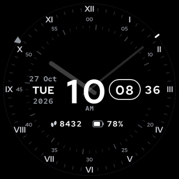

# Orbit Index

A monochrome hybrid watch face for the **Amazfit GTR Mini** (Zepp OS 2.0, 416 × 416). A large digital hour sits beside a minute window and a live seconds readout, while Roman numerals, small minute numbers and two faint hands give an analog read. A tick ring turns once a minute to carry the seconds.



Shows: time (12h/24h with AM/PM), seconds, date, weekday, year, steps and battery.

## What's here

| Path | Contents |
| --- | --- |
| [`design/index.html`](design/index.html) | Interactive web version of the design. Open it in a browser; change time, date, steps and battery to see the face react |
| [`assets/`](assets/) | Every PNG for the Watchface Maker, already sized for 416 × 416 |
| [`WATCHFACE_MAKER_GUIDE.md`](WATCHFACE_MAKER_GUIDE.md) | Step-by-step setup with every coordinate, install by QR code, troubleshooting and publishing |
| [`store/listing.md`](store/listing.md) | Name, description and features text for the Zepp store listing |
| [`generator/`](generator/) | Script that renders all of `assets/` from code |

## Rebuilding the assets

```bash
git clone --depth 1 https://github.com/RedHatOfficial/RedHatFont.git generator/RedHatFont
pip install playwright pillow && playwright install chromium
python generator/run.py assets
```

The script writes every image, `reference/layout.json` with all positions, and mock-ups of the finished face. Edit `generator/gen.js` to change the design, then re-run.

## Fonts

Red Hat Display and Red Hat Mono, © Red Hat, SIL Open Font License 1.1. The fonts are not stored in this repo; the generator loads them from a local clone.
